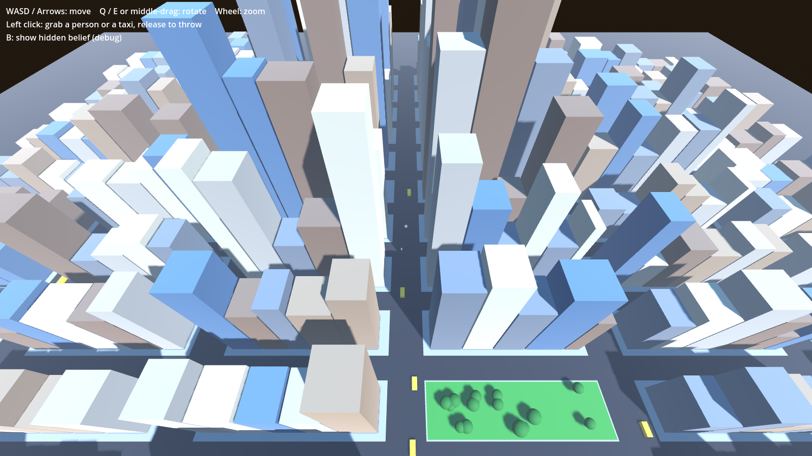

# Godministration (שם זמני)

משחק אל קומי: אל אחד נגד הביורוקרטיה של עיר בסגנון ניו יורק, רובע אחרי רובע, עד בניין העירייה. היד היא כל הממשק. כרגע יש רובע אחד, ה-Slums, ומהדקים אותו לפני שממשיכים.

מסמך העיצוב: [docs/GDD.md](docs/GDD.md). ספר האמנות: [docs/ART.md](docs/ART.md).

## לשחק באלפה העדכנית

**בדפדפן (מומלץ):** https://eilamshahaf-droid.github.io/balck-and-white-3/
הקישור תמיד פותח את הגרסה האחרונה של האלפה. עדיף Chrome או Edge במחשב עם כרטיס מסך; הטעינה הראשונה לוקחת כמה שניות.

**כגיבוי, להורדה:** https://github.com/eilamshahaf-droid/balck-and-white-3/archive/refs/heads/alpha.zip

## איך משחקים ברובע

המודל החדש, סבבים א' (הכלכלה) ו-ב' (הסכנה) מתוך שלושה. המטרה (כיבוש בנייני המפתח) מגיעה בסבב ג'.

0. **הפתיחה.** בפעם הראשונה רואים סצנת פתיחה קצרה בחמישה מסכים: Next מתקדם ו-Skip מדלג.
1. מתחילים עם המשרד הראשי (גג זהב) בקצה הרובע, 600 דולר ו-100 ניירת. המשרד ריק. כרטיס המשימה למעלה משמאל מלמד צעד אחד בכל פעם: חנות, חדר פקידים, שתי דירות משפחה (אנשים עובדים איפה שהם גרים), שליחת הנציג, בניין ראשון, חיסכון לחדר הכשרה, פקח, Fixer. ארבעת החדרים הראשונים שקונים במשרד לא מתייקרים, כך שהשיעור הראשון עולה בדיוק 600 דולר ו-50 ניירת. צעד שנעשה לא חוזר.
2. **עוקבים הם מספר.** לכל בניין שלך יש מקום לעוקבים לפי הגודל שלו. בניין חדש מתחיל חצי מלא ומתמלא לבד. כולם מאגר אחד. אין בניינים ריקים.
3. **תפקידים מתמלאים לבד מהמאגר.** פקידים במשרד מייצרים ניירת (Paperwork), מוכרים בחנויות מכניסים כסף. כל מוכר נוסף באותה חנות מכניס פחות, ולכן המשחק מעסיק רק את מי ששווה את השכר שלו. בגלגל החנות אפשר להוסיף או לשחרר מוכר ורואים כמה הבא יכניס.
4. **נציג (Rep).** הנציג הראשון מחכה ליד המשרד כבר בהתחלה, בחינם. עוד נציגים: מחזיקים את הלחצן על המשרד ובוחרים Train Rep. מעל המשרד מופיע מד הכשרה (מי, כמה אחוז, כמה שניות נשארו), ולנציג ול-Fixer יש תג מעל הראש. זה עולה ניירת ועוקב אחד מהמאגר. **כל נציג עולה 0.1 ניירת בשנייה** כל עוד הוא קיים, מנהל רבע מזה, וה-Fixer 0.2; פקיד מייצר 0.25. כרטיס הניירת מראה את הקצב נטו. כשהניירת נגמרת, כל 10 שניות נציג אחד שאינו מנהל חוזר להיות עוקב רגיל, ואחריו ה-Fixer. מנהלים נשארים. יש תקרה: שני נציגים בחוץ, ועוד אחד על כל שדרוג Training Room במשרד.
5. **לקחת בניין.** מחזיקים את הלחצן על בניין בטווח ובוחרים Send a Rep, או מרימים נציג ומניחים אותו ליד הדלת. הפס מעל הבניין מתמלא, לאט יותר בבניין גדול ומהר יותר עם שני נציגים. כשהוא מלא הבניין שלך, והנציג נשאר בו כמנהל (Manager) ומפנה מקום בתקרה.
6. **תשומת הלב של האל.** בניין שהיד מרחפת מעליו מתמלא פי שניים מהר. גם הכשרה במשרד.
7. **בתוך בלוק** בניינים שליד בניין שלך מתמלאים לבד, לאט. פס ירוק מלא פירושו שהבניין רוצה אותך וצריך רק נציג. בלוק שכולו שלך מושך עוקבים מהר יותר.
7א. **רדיוס השפעה ורושם.** נציג יכול לעבוד על בניין עד 1 + שורש(עוקבים ÷ 60) בניינים מהבניינים שלך: 2 ב-60 עוקבים, 3 ב-240, 4 ב-540, בלי תקרה. השורה למטה משמאל מראה את הטווח ומתי מגיעה הטבעת הבאה. בנייני מפתח עדיין חייבים לגבול בבניין שלך. לכל בניין רגיל יש **רושם**: כל בניין שלך בטווח נותן 1, ועוד 1 לכל דירה בו, 2 לכל חנות ו-5 לחדר כביסה. הבניין הבא צריך 3, ועוד 0.3 על כל בניין רגיל שלך אחרי השניים הראשונים. הרושם מופיע רק בכרטיס שמתחת ליד ("Impression 4 of 5"). כשאין מספיק, Send a Rep מסרב ואומר מה לבנות.
8. **חדרים.** לחיצה כפולה על בניין שלך (או להחזיק את הלחצן ולבחור Rooms). הבניין הוא רשת של חלונות וקומות; מקום ריק הוא דירה רגילה לעוקב אחד, כך שאפשר להתעלם מכל זה. בוחרים חדר מהרשימה, מסובבים בלחצן הימני או בגלגלת, ולוחצים על מקום פנוי. חדרים עולים כסף ולפעמים ניירת, וכל חדר שכבר קנית באותו בניין מייקר את הבא ב-25% (בבניין אחר המחיר מתחיל מחדש; חדר הכשרה, ארכיון וכספת לא מתייקרים). חנות עולה 150 דולר: דירות טובות יותר, חדר שמירה, חנות (בקומת הקרקע), ובמשרד גם חדר פקידים, ארכיון (מעלה את תקרת הניירת), כספת (מעלה את תקרת הכסף) וחדר הכשרה (עוד נציג). הוצאת חדר מחזירה חצי מהכסף. בכל קומה יש משבצת מדרגות אחת שאי אפשר לבנות עליה; המדרגות עולות שתי קומות בעמודה אחת ואז עוברות לעמודה אחרת. אנשים עובדים איפה שהם גרים: חנות או חדר פקידים מעסיקים לכל היותר את מספר העוקבים שגרים באותו בניין, והכרטיס מעל הבניין והמתכנן אומרים "needs homes here" כשחסרים. כל בניין שלך עולה 4 דולר לדקה (חצי בבלוק שלם, ופחות כשיש מעט כסף: כלום ב-0 דולר, הכול מ-250 דולר), ולחלק מהחדרים יש תחזוקה בכסף לדקה (חדר שמירה, מחסן סחורה, חדר כביסה); כשאין כסף החדר היקר ביותר נסגר עד שיש שוב. ארכיון חייב לגעת בחדר פקידים וכספת בחנות, וחדר שנשענים עליו אי אפשר להוציא. ב-Slums יש רק חדרי מגורים בסיסיים: דירת משפחה (2 מקומות, 5 עוקבים) ודירת שורה (3 מקומות, 9 עוקבים). דירה חדשה מביאה מיד חצי מהעוקבים שהיא מוסיפה, והשאר מגיעים לאט. צו הקומות (+Floors) מוסיף שורות לרשת.
8א. **תקרות.** לניירת ולכסף יש תקרה (150 ו-600 דולר בהתחלה). הכרטיסים למעלה מראים "78 of 150". **רווח עוצר את הזמן**; היד, הגלגלים והעורך ממשיכים לעבוד.
9. **פקחים.** פקיד של העירייה על שעון: הראשון אחרי שתי דקות וחצי, ואחר כך אחד כל שתי דקות (כרטיס החשיפה סופר לאחור). ככל שהחשיפה (EXPOSURE) גבוהה יותר יוצאים יותר בבת אחת. הוא הולך מבניין מפתח (שלט אדום) לבניין שלך (לא המשרד) ולוקח 15 ניירת ועוד 1 על כל בניין שלך (פחות עם חדר שמירה). אם אין מספיק, הוא לוקח מה שיש וחוזר אחרי 90 שניות. אפשר להרים אותו ולזרוק אותו רחוק כדי להרוויח זמן. Bury the File במשרד מוריד חשיפה תמורת ניירת.
10. **בנייני מפתח וה-Fixer.** מכשירים Fixer במשרד (80 ניירת) ומניחים אותו ביד ליד כל בניין מפתח (שלט אדום), גם אם הוא לא גובל בבניין שלך, או בוחרים Send the Fixer בגלגל של הבניין. כשהוא ליד הדלת, מחזיקים את הלחצן על הבניין ובוחרים פעולה: לכל בניין מפתח פעולות משלו. פעולה שקטה זולה וממלאת קצת מהפס, פעולה רועשת ממלאת הרבה אבל שולחת פקח לדלת, ואם אין לו ניירת ה-Fixer חוזר למשרד והפס יורד. כל פעולה עולה ניירת, כסף וחשיפה, ומ-70% חשיפה הוא לא עושה כלום עד שהיא יורדת. חדר שמירה (Guard Room) באחד הבניינים שלך מחפה עליו: פעולות מוסיפות 20% פחות חשיפה, ופעולה רועשת שנכשלה מורידה 15% מהפס במקום 30%. פס מלא פותח את הבניין, ונציג מבניין שגובל בו לוקח אותו כרגיל. בניין מפתח שלך הוא משרד: אפשר לבנות בו חדרי פקידים, ארכיון, כספת וחדר הכשרה.
11. **ניצחון, שתי דרכים:** 80% מבנייני המפתח, או 30% מהם יחד עם 60% מתושבי הרובע. תושבי הרובע הם העוקבים שלך ועוד הדיירים של כל בניין שאינו שלך, ועוקבים שהוספת להם מקום נספרים גם בסך הכול. השורה למטה משמאל מראה את המספרים.

## מעצב החדרים

בתוך המשחק לוחצים F1 ובוחרים Room designer (חזרה: Back to game). בוחרים סוג חדר (כל ה-14) ורמה (1 עד 3). החדר נראה פתוח מלפנים: המקומות שלו צבועים בצבע שלו, ושאר הקופסה אפורה. בוחרים רהיט משמאל (124 רהיטים של Kenney, עם חיפוש וקבוצות) ולוחצים על מקום צבוע, או גוררים אותו לשם. רהיט עומד על הרצפה או על שולחן או דלפק שמתחתיו; מנורות קיר וארונות עליונים נתלים על הקיר האחורי. לוחצים על רהיט כדי לבחור אותו: גוררים כדי להזיז, Back/Mid/Front או מחוון לעומק, מחוונים לגובה ולגודל, R מסובב, Delete מוחק, Ctrl+Z מבטל. ב-3D edit מניחים וגוררים רהיטים בתלת-ממד. כל שינוי נשמר מיד, גם בדפדפן. Download room מוריד את קובץ החדר, Download all את כל החדרים, ו-Load file טוען קובץ (גם מהעורך של האמן).

## איך מריצים את ההורדה

1. פותחים את Godot 4 (גרסה 4.3 ומעלה).
2. במסך הפרויקטים לוחצים **Import**, ובוחרים את הקובץ `project.godot` מהתיקייה הזו.
3. לוחצים **F5** (או על כפתור ה-Play למעלה מימין).

## שליטה

היד היא הממשק, כמו ב-Black & White:

| פעולה | מה קורה |
| --- | --- |
| גרירה עם הלחצן השמאלי על הקרקע או גג | תופסים את העיר ומזיזים אותה |
| גרירה עם הלחצן השמאלי על אדם או מונית | מרימים. שחרור במקום = הנחה, שחרור תוך תנועה = זריקה |
| לחיצה קצרה על אדם או מונית | הקשה: אדם מסתובב, מונית קופצת ומפעילה אזעקה |
| לחיצה קצרה על קיר או רחוב | דפיקה: הדלת הקרובה נפתחת ואנשים מסביב מסתכלים |
| לחיצה כפולה | על בניין שלך: החדרים שלו; בכל מקום אחר המצלמה טסה לנקודה |
| גרירה עם הכפתור האמצעי | סיבוב סביב הנקודה שמתחת לעכבר |
| גלגלת, או שני הלחצנים + תנועה | זום אל העכבר |
| WASD, Q/E, R/F | הזזה, סיבוב, הטיה במקלדת |
| B | כרטיס פיתוח: מרחפים מעל אדם ורואים מי הוא ומה הדרגה שלו |
| לוח Debug (F1 פותח וסוגר) | ניירת +, כסף +, לקיחת הבניינים הקרובים למרכז המסך |
| החזקת הלחצן השמאלי על הקרקע בלי לזוז (חצי שנייה) | גלגל הניסים נפתח סביב היד: מים, כסף, מסיבת רחוב, גשם צפרדעים. שחרור שם את הנס ביד, לחיצה מטילה אותו, לחיצה ימנית מבטלת. ניסים עולים ניירת |
| גרירה עם הלחצן הימני בצורת עיגול | קיצור לנס המים: ענן קטן יורד גשם על המקום שציירת ומכבה שריפות |
| החזקת הלחצן השמאלי על בניין בלי לזוז (חצי שנייה) | על בניין שלך: חדרים, קומות, מוכרים, ובמשרד גם הכשרה, הלוואה ו-Bury the File. על בניין שגובל בשלך: Send a Rep |
| רווח | עצירת הזמן |

## מודל תכנון העיר (סצנה נפרדת לבדיקה)

סצנה בלי אל ובלי אנשים, רק המודל של תכנון העיר. העיר עומדת על שטח תלת־ממדי עם גבעות ונהר. הרחובות שלה נבנו לפי הטופוגרפיה: ישרים במישור, מתעקלים סביב גבעות, מדרגות להולכי רגל במקומות התלולים, וגשרים רק בכמה שדרות. אפשר לשרטט רחובות, שדרות ושבילים חדשים כמו ב-BW2. כל רחוב חדש חוצה את הרחובות שבדרך, והבלוקים מקבלים מחדש את הצורה והגודל שלהם לפי הרחובות שסביבם. המגרשים מסודרים לאורך הרחובות ופונים אליהם, ובניינים על מדרון עומדים על בסיס אבן.

העיר ממשיכה לגדול לבד: המקומות המבוקשים נבנים קודם, הגובה הולך אחרי ערך הקרקע, וכל בניין נבנה מחדש בהדרגה במראה של האל ששולט ברחוב שלו: טוב (צבעים חמים, גינות על הגגות), רע (בטון אפור, ניאון אדום) או ניטרלי (זכוכית, שלטי חוצות). מבנה על גבעה משפיע רחוק יותר, כמו בונוס הגבעה של BW2.

איך פותחים:
1. ב-Godot, בחלונית FileSystem (למטה משמאל), פותחים את התיקייה `scenes`.
2. לוחצים פעמיים על `city_planning.tscn`.
3. לוחצים **F6** (או על הכפתור Run Current Scene למעלה מימין, זה שליד ה-Play). F5 עדיין מריץ את המשחק הרגיל.

שלוש תוכניות לדוגמה (הכפתורים למעלה), כולן על אותה עיר התחלתית ועם אותם כלים שיש לשחקן:
- **אל טוב**, ג'ייקובס וגל: שבילים שחוצים את הבלוקים הגדולים לבלוקים קצרים, רחובות בלי מכוניות במרכז, עירוב מגורים ומסחר, מקדש וכיכרות, פארקים על הגבעות, עצים, ספסלים ומקדשים קטנים.
- **אל רע**, מוזס והאוסמן: שתי שדרות ישרות שנחתכות דרך הרחובות הישנים ומעל הגבעות, אנדרטה במפגש שלהן ועוד אחת על הגבעה הגבוהה, מפעלים ליד הנהר, שיכונים לידם ומצלמות לאורך השדרות.
- **אל ניטרלי**, כלכלת ריכוז: שדרה חדשה שמובילה את הקו לאורך העיר, שלוש תחנות עליה ורובע עסקים צפוף סביב כל אחת, מגדלי מטה על הגבעות הסמוכות ושלטי חוצות.

| פעולה | מה קורה |
| --- | --- |
| רחובות: רחוב, שדרה, שביל | לוחצים וגוררים כדי לשרטט. הקו ירוק כשהשיפוע מתון, צהוב כשהוא תלול ואדום כשהוא תלול מדי. הכביש מתעקל לבד סביב המדרונות, ועם "Straight" הוא נבנה בדיוק כמו ששורטט |
| Car-free / Remove road | לחיצה על רחוב סוגרת אותו למכוניות (כיכר לאורכו) או פותחת אותו שוב. הסרה מוחקת רחוב, והבלוקים מתאחדים |
| שכונה | מגורים, מסחר, תעשייה, ניקוי, צפוף יותר, דליל יותר. אפשר "לצבוע" בגרירה |
| מגרש | מקדש, כיכר, פארק, תחנה, מגדל מטה, מפעל, אנדרטה. המבנה נבנה לאורך הרחוב הקרוב, פונה אליו |
| פרטי רחוב | עץ, ספסל, מקדש קטן, מצלמה, שלט חוצות, הסרה |
| ריחוף | הבלוק מסומן בקו לבן, למטה כתובים הגובה והשיפוע, ועם מבנה ביד רואים טבעת השפעה וכמה הוא יוסיף |
| 1 עד 7 | שכבות צבע: בלי, ייעוד, אמונה, מסחר, איכות חיים, פחד, השפעה |
| WASD או גרירה ימנית | הזזת המצלמה. גלגלת = זום, Q/E = סיבוב, R/F = הטיה |
| רווח | עצירה של הצמיחה |

כל המספרים (גובה הגבעות, רוחב הנהר והרחובות, שיפוע מקסימלי, עומק המגרשים, כמה כל מבנה נותן ועד איזה מרחק) נמצאים ב-`data/planning.tres`.

## כיוונון התחושה

כל המספרים של היד והמצלמה נמצאים בקובץ `data/hand_settings.tres`. לוחצים עליו פעמיים בחלונית FileSystem ב-Godot, ומשנים ערכים בחלונית Inspector (למשל חוזק הקפיץ, מהירות זריקה, מהירות המצלמה). ערך שימושי במיוחד: `grab_reach` (כמה סלחנית האחיזה של כל היד).

## סגנון אמנותי: בית בובות בצבעי מים

העולם מצויר ב-cel shading רך (שלוש רמות אור, צללים בגוון לבנדר) עם שכבת צבעי מים ונייר על כל המסך. לוחצים **V** במשחק כדי להשוות למראה הפשוט. ככל שהמצלמה גבוהה יותר, החלק העליון והתחתון של המסך מיטשטשים קצת (טילט-שיפט), כך שהעיר נראית כמו דגם ביד.

כל המספרים של הסגנון נמצאים ב-`data/art_style.tres`: כמה כהה הצד המוצל, כמה רכים המעברים, גוון הצל, עוצמת כתמי הצבע, הקצוות, הגרגור והנייר. לוחצים עליו פעמיים ב-FileSystem ומשנים ב-Inspector.

הקוד שמשחק לא צריך לדעת על הסגנון: הוא ממשיך ליצור חומרים רגילים, ו-`scripts/art_style.gd` מחליף אותם בשיידר. היד של האל, אש, גשם, צללים ומסכי טלפון נשארים בלי שינוי.

## מה יש כרגע

- רובע אחד, ה-Slums: 97 בניינים בתשעה בלוקים גדולים (8 עד 13 בניינים) ועוד בניין הליבה, ממפה שנוצרה ב-Map Lab. בכל בלוק חוץ מזה של המשרד יש בניין מפתח.
- הכלכלה של המודל החדש (סבב א'): עוקבים כמספר לכל בניין, תפקידים שמתמלאים לבד, חנויות, ניירת, תקרת נציגים, הלוואה, תשומת הלב של האל.
- מצלמה ויד בסגנון Black & White. היד מרימה נציגים, פקחים, מוניות וחפצים ברחוב. רק נציגים עובדים על בניין; המזכיר נשאר במשרד.
- ארבעה ניסים (מים, כסף, מסיבת רחוב, גשם צפרדעים). רשימת הניסים והמלאי שלהם ייבנו מחדש בהמשך.
- הסכנה (סבב ב'): חשיפה, בנייני מפתח ששולחים פקחים, ניירת כמגן.
- עדיין לא: כיבוש בנייני מפתח, ה-Fixer בפעולה ותנאי הניצחון (סבב ג').

## מבנה

המבנה המלא של הקוד, הסצנות וקובצי המספרים מתואר ב-[CLAUDE.md](CLAUDE.md) (באנגלית). יומן העדכונים: [CHANGELOG.md](CHANGELOG.md).
