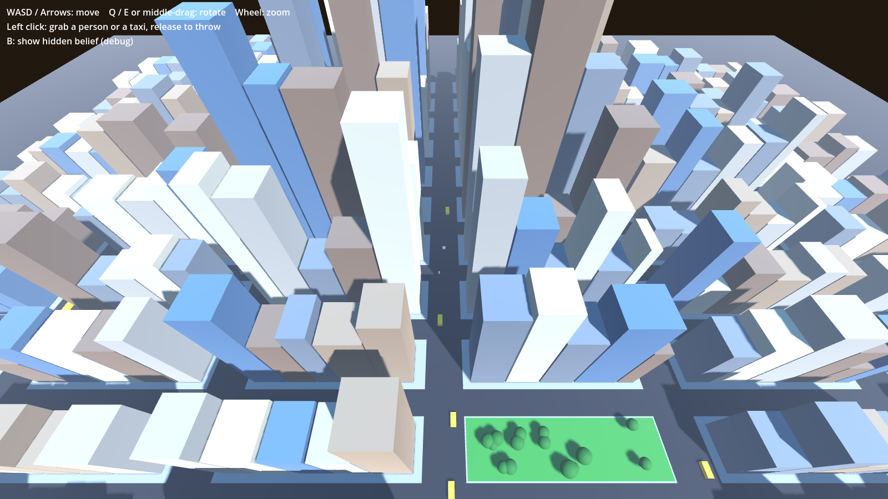

# Spin Cycle (שם זמני)

משחק אל קומי: אל אחד נגד הביורוקרטיה של עיר בסגנון ניו יורק, רובע אחרי רובע, עד בניין העירייה. היד היא כל הממשק. כרגע יש רובע אחד, ה-Slums, ומהדקים אותו לפני שממשיכים.

מסמך העיצוב: [docs/GDD.md](docs/GDD.md). ספר האמנות: [docs/ART.md](docs/ART.md).

## לשחק באלפה העדכנית

**בדפדפן (מומלץ):** https://eilamshahaf-droid.github.io/balck-and-white-3/
הקישור תמיד פותח את הגרסה האחרונה של האלפה. עדיף Chrome או Edge במחשב עם כרטיס מסך; הטעינה הראשונה לוקחת כמה שניות.

**כגיבוי, להורדה:** https://github.com/eilamshahaf-droid/balck-and-white-3/archive/refs/heads/alpha.zip

## איך משחקים ברובע

המודל החדש, סבבים א' (הכלכלה) ו-ב' (הסכנה) מתוך שלושה. המטרה (כיבוש בנייני המפתח) מגיעה בסבב ג'.

1. מתחילים עם המשרד הראשי (גג זהב) בקצה הרובע. הוא הלב: גרים בו עוקבים, יש בו חנות, פקידים והכשרה. כרטיס המשימה למעלה משמאל אומר מה הצעד הבא.
2. **עוקבים הם מספר.** לכל בניין שלך יש מקום לעוקבים לפי הגודל שלו. בניין חדש מתחיל חצי מלא ומתמלא לבד. כולם מאגר אחד. אין בניינים ריקים.
3. **תפקידים מתמלאים לבד מהמאגר.** פקידים במשרד מייצרים ניירת (Paperwork), מוכרים בחנויות מכניסים כסף. כל מוכר נוסף באותה חנות מכניס פחות, ולכן המשחק מעסיק רק את מי ששווה את השכר שלו. בגלגל החנות אפשר להוסיף או לשחרר מוכר ורואים כמה הבא יכניס.
4. **נציג (Rep).** מחזיקים את הלחצן על המשרד ובוחרים Train Rep. זה עולה ניירת ועוקב אחד מהמאגר. יש תקרה: שני נציגים בחוץ, ועוד אחד על כל שדרוג Training Room במשרד.
5. **לקחת בניין.** מחזיקים את הלחצן על בניין שגובל בבניין שלך ובוחרים Send a Rep, או מרימים נציג ומניחים אותו ליד הדלת. הפס מעל הבניין מתמלא, לאט יותר בבניין גדול ומהר יותר עם שני נציגים. כשהוא מלא הבניין שלך, והנציג נשאר בו כמנהל (Manager) ומפנה מקום בתקרה.
6. **תשומת הלב של האל.** בניין שהיד מרחפת מעליו מתמלא פי שניים מהר. גם הכשרה במשרד.
7. **בתוך בלוק** בניינים שליד בניין שלך מתמלאים לבד, לאט. פס ירוק מלא פירושו שהבניין רוצה אותך וצריך רק נציג. בלוק שכולו שלך מושך עוקבים מהר יותר.
8. **חדרים.** מחזיקים את הלחצן על בניין שלך ובוחרים Rooms. הבניין הוא רשת של חלונות וקומות; מקום ריק הוא דירה רגילה לעוקב אחד, כך שאפשר להתעלם מכל זה. בוחרים חדר מהרשימה, מסובבים בלחצן הימני או בגלגלת, ולוחצים על מקום פנוי. חדרים עולים כסף ולפעמים ניירת: דירות טובות יותר, חדר משותף שמושך עוקבים, חדר שמירה, חנות (בקומת הקרקע), ובמשרד גם חדר פקידים, ארכיון (מעלה את תקרת הניירת), כספת (מעלה את תקרת הכסף) וחדר הכשרה (עוד נציג). הוצאת חדר מחזירה חצי מהכסף. צו הקומות (+Floors) מוסיף שורות לרשת.
8א. **תקרות.** לניירת ולכסף יש תקרה (150 ו-1,200 דולר בהתחלה). הכרטיסים למעלה מראים "78 of 150". **רווח עוצר את הזמן**; היד, הגלגלים והעורך ממשיכים לעבוד.
9. **פקחים.** בנייני המפתח (שלט אדום על הגג) שולחים פקחים, עם סימן קריאה אדום מעל הראש, אל נציגים שעובדים. פקח שמגיע דורש ניירת: אם יש, הנציג מציג ניירות וממשיך; אם אין, הנציג נשלח הביתה. אפשר להרים פקח ביד ולהניח אותו רחוק כדי להרוויח זמן, ואחרי שתי דקות וחצי הוא מתייאש. ככל שהחשיפה (EXPOSURE) עולה יוצאים יותר פקחים, והם מתחילים גם לבקר בניינים שלך: בלי ניירת הבניין אובד. שדרוג Security מוזיל ביקורת, בלוק שלם מוגן, ו-Bury the File במשרד מוריד חשיפה תמורת ניירת.
10. ניצחון, בינתיים: מד הרובע מתמלא לפי חלק הבניינים שלך. שני תנאי הניצחון האמיתיים (בנייני מפתח) מגיעים בסבב ג'.

## איך מריצים את ההורדה

1. פותחים את Godot 4 (גרסה 4.3 ומעלה).
2. במסך הפרויקטים לוחצים **Import**, ובוחרים את הקובץ `project.godot` מהתיקייה הזו.
3. לוחצים **F5** (או על כפתור ה-Play למעלה מימין).

## שליטה

היד היא הממשק, כמו ב-Black & White:

| פעולה | מה קורה |
| --- | --- |
| גרירה עם הלחצן השמאלי על הקרקע או גג | תופסים את העיר ומזיזים אותה |
| גרירה עם הלחצן השמאלי על אדם או מונית | מרימים. שחרור במקום = הנחה, שחרור תוך תנועה = זריקה |
| לחיצה קצרה על אדם או מונית | הקשה: אדם מסתובב, מונית קופצת ומפעילה אזעקה |
| לחיצה קצרה על קיר או רחוב | דפיקה: הדלת הקרובה נפתחת ואנשים מסביב מסתכלים |
| לחיצה כפולה | המצלמה טסה לנקודה |
| גרירה עם הכפתור האמצעי | סיבוב סביב הנקודה שמתחת לעכבר |
| גלגלת, או שני הלחצנים + תנועה | זום אל העכבר |
| WASD, Q/E, R/F | הזזה, סיבוב, הטיה במקלדת |
| B | כרטיס פיתוח: מרחפים מעל אדם ורואים מי הוא ומה הדרגה שלו |
| לוח Debug (F1 פותח וסוגר) | ניירת +, כסף +, לקיחת הבניינים הקרובים למרכז המסך |
| החזקת הלחצן השמאלי על הקרקע בלי לזוז (חצי שנייה) | גלגל הניסים נפתח סביב היד: מים, כסף, מסיבת רחוב, גשם צפרדעים. שחרור שם את הנס ביד, לחיצה מטילה אותו, לחיצה ימנית מבטלת. ניסים עולים ניירת |
| גרירה עם הלחצן הימני בצורת עיגול | קיצור לנס המים: ענן קטן יורד גשם על המקום שציירת ומכבה שריפות |
| החזקת הלחצן השמאלי על בניין בלי לזוז (חצי שנייה) | על בניין שלך: חדרים, קומות, מוכרים, ובמשרד גם הכשרה, הלוואה ו-Bury the File. על בניין שגובל בשלך: Send a Rep |
| רווח | עצירת הזמן |

## מודל תכנון העיר (סצנה נפרדת לבדיקה)

סצנה בלי אל ובלי אנשים, רק המודל של תכנון העיר. העיר עומדת על שטח תלת־ממדי עם גבעות ונהר. הרחובות שלה נבנו לפי הטופוגרפיה: ישרים במישור, מתעקלים סביב גבעות, מדרגות להולכי רגל במקומות התלולים, וגשרים רק בכמה שדרות. אפשר לשרטט רחובות, שדרות ושבילים חדשים כמו ב-BW2. כל רחוב חדש חוצה את הרחובות שבדרך, והבלוקים מקבלים מחדש את הצורה והגודל שלהם לפי הרחובות שסביבם. המגרשים מסודרים לאורך הרחובות ופונים אליהם, ובניינים על מדרון עומדים על בסיס אבן.

העיר ממשיכה לגדול לבד: המקומות המבוקשים נבנים קודם, הגובה הולך אחרי ערך הקרקע, וכל בניין נבנה מחדש בהדרגה במראה של האל ששולט ברחוב שלו: טוב (צבעים חמים, גינות על הגגות), רע (בטון אפור, ניאון אדום) או ניטרלי (זכוכית, שלטי חוצות). מבנה על גבעה משפיע רחוק יותר, כמו בונוס הגבעה של BW2.

איך פותחים:
1. ב-Godot, בחלונית FileSystem (למטה משמאל), פותחים את התיקייה `scenes`.
2. לוחצים פעמיים על `city_planning.tscn`.
3. לוחצים **F6** (או על הכפתור Run Current Scene למעלה מימין, זה שליד ה-Play). F5 עדיין מריץ את המשחק הרגיל.

שלוש תוכניות לדוגמה (הכפתורים למעלה), כולן על אותה עיר התחלתית ועם אותם כלים שיש לשחקן:
- **אל טוב**, ג'ייקובס וגל: שבילים שחוצים את הבלוקים הגדולים לבלוקים קצרים, רחובות בלי מכוניות במרכז, עירוב מגורים ומסחר, מקדש וכיכרות, פארקים על הגבעות, עצים, ספסלים ומקדשים קטנים.
- **אל רע**, מוזס והאוסמן: שתי שדרות ישרות שנחתכות דרך הרחובות הישנים ומעל הגבעות, אנדרטה במפגש שלהן ועוד אחת על הגבעה הגבוהה, מפעלים ליד הנהר, שיכונים לידם ומצלמות לאורך השדרות.
- **אל ניטרלי**, כלכלת ריכוז: שדרה חדשה שמובילה את הקו לאורך העיר, שלוש תחנות עליה ורובע עסקים צפוף סביב כל אחת, מגדלי מטה על הגבעות הסמוכות ושלטי חוצות.

| פעולה | מה קורה |
| --- | --- |
| רחובות: רחוב, שדרה, שביל | לוחצים וגוררים כדי לשרטט. הקו ירוק כשהשיפוע מתון, צהוב כשהוא תלול ואדום כשהוא תלול מדי. הכביש מתעקל לבד סביב המדרונות, ועם "Straight" הוא נבנה בדיוק כמו ששורטט |
| Car-free / Remove road | לחיצה על רחוב סוגרת אותו למכוניות (כיכר לאורכו) או פותחת אותו שוב. הסרה מוחקת רחוב, והבלוקים מתאחדים |
| שכונה | מגורים, מסחר, תעשייה, ניקוי, צפוף יותר, דליל יותר. אפשר "לצבוע" בגרירה |
| מגרש | מקדש, כיכר, פארק, תחנה, מגדל מטה, מפעל, אנדרטה. המבנה נבנה לאורך הרחוב הקרוב, פונה אליו |
| פרטי רחוב | עץ, ספסל, מקדש קטן, מצלמה, שלט חוצות, הסרה |
| ריחוף | הבלוק מסומן בקו לבן, למטה כתובים הגובה והשיפוע, ועם מבנה ביד רואים טבעת השפעה וכמה הוא יוסיף |
| 1 עד 7 | שכבות צבע: בלי, ייעוד, אמונה, מסחר, איכות חיים, פחד, השפעה |
| WASD או גרירה ימנית | הזזת המצלמה. גלגלת = זום, Q/E = סיבוב, R/F = הטיה |
| רווח | עצירה של הצמיחה |

כל המספרים (גובה הגבעות, רוחב הנהר והרחובות, שיפוע מקסימלי, עומק המגרשים, כמה כל מבנה נותן ועד איזה מרחק) נמצאים ב-`data/planning.tres`.

## כיוונון התחושה

כל המספרים של היד והמצלמה נמצאים בקובץ `data/hand_settings.tres`. לוחצים עליו פעמיים בחלונית FileSystem ב-Godot, ומשנים ערכים בחלונית Inspector (למשל חוזק הקפיץ, מהירות זריקה, מהירות המצלמה). ערך שימושי במיוחד: `grab_reach` (כמה סלחנית האחיזה של כל היד).

## סגנון אמנותי: בית בובות בצבעי מים

העולם מצויר ב-cel shading רך (שלוש רמות אור, צללים בגוון לבנדר) עם שכבת צבעי מים ונייר על כל המסך. לוחצים **V** במשחק כדי להשוות למראה הפשוט. ככל שהמצלמה גבוהה יותר, החלק העליון והתחתון של המסך מיטשטשים קצת (טילט-שיפט), כך שהעיר נראית כמו דגם ביד.

כל המספרים של הסגנון נמצאים ב-`data/art_style.tres`: כמה כהה הצד המוצל, כמה רכים המעברים, גוון הצל, עוצמת כתמי הצבע, הקצוות, הגרגור והנייר. לוחצים עליו פעמיים ב-FileSystem ומשנים ב-Inspector.

הקוד שמשחק לא צריך לדעת על הסגנון: הוא ממשיך ליצור חומרים רגילים, ו-`scripts/art_style.gd` מחליף אותם בשיידר. היד של האל, אש, גשם, צללים ומסכי טלפון נשארים בלי שינוי.

## מה יש כרגע

- רובע אחד, ה-Slums: 174 בניינים ב-41 בלוקים, ממפה שנוצרה ב-Map Lab.
- הכלכלה של המודל החדש (סבב א'): עוקבים כמספר לכל בניין, תפקידים שמתמלאים לבד, חנויות, ניירת, תקרת נציגים, הלוואה, תשומת הלב של האל.
- מצלמה ויד בסגנון Black & White. היד מרימה נציגים, פקחים, מוניות וחפצים ברחוב. רק נציגים עובדים על בניין; המזכיר נשאר במשרד.
- ארבעה ניסים (מים, כסף, מסיבת רחוב, גשם צפרדעים). רשימת הניסים והמלאי שלהם ייבנו מחדש בהמשך.
- הסכנה (סבב ב'): חשיפה, בנייני מפתח ששולחים פקחים, ניירת כמגן.
- עדיין לא: כיבוש בנייני מפתח, ה-Fixer בפעולה ותנאי הניצחון (סבב ג').

## מבנה

המבנה המלא של הקוד, הסצנות וקובצי המספרים מתואר ב-[CLAUDE.md](CLAUDE.md) (באנגלית). יומן העדכונים: [CHANGELOG.md](CHANGELOG.md).
