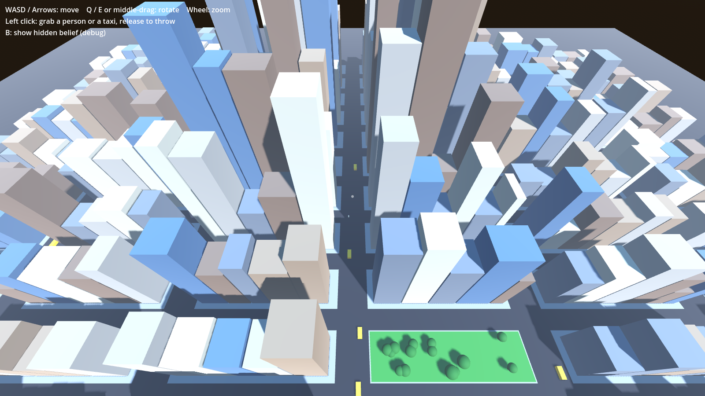

# Black & White 3

משחק אל בעידן המודרני: אתה אל אמיתי, אבל העולם מתכחש אליך. בונים מאמינים דרך נתיב הטוב, נתיב הרע והמלחמה, או נתיב כלכלי-פוליטי.

מסמך העיצוב: https://claude.ai/artifact/XXmWFvEAG1smApSyEv6BmH

## איך מריצים

1. פותחים את Godot 4 (גרסה 4.3 ומעלה).
2. במסך הפרויקטים לוחצים **Import**, ובוחרים את הקובץ `project.godot` מהתיקייה הזו.
3. לוחצים **F5** (או על כפתור ה-Play למעלה מימין).

## שליטה

היד היא הממשק, כמו ב-Black & White:

| פעולה | מה קורה |
| --- | --- |
| גרירה עם הלחצן השמאלי על הקרקע או גג | תופסים את העיר ומזיזים אותה |
| גרירה עם הלחצן השמאלי על אדם או מונית | מרימים. שחרור במקום = הנחה, שחרור תוך תנועה = זריקה |
| לחיצה קצרה על אדם או מונית | הקשה: אדם מסתובב, מונית קופצת ומפעילה אזעקה |
| לחיצה קצרה על קיר או רחוב | דפיקה: הדלת הקרובה נפתחת ואנשים מסביב מסתכלים |
| לחיצה כפולה | המצלמה טסה לנקודה |
| גרירה עם הכפתור האמצעי | סיבוב סביב הנקודה שמתחת לעכבר |
| גלגלת, או שני הלחצנים + תנועה | זום אל העכבר |
| WASD, Q/E, R/F | הזזה, סיבוב, הטיה במקלדת |
| B | הצגת מדד האמונה הנסתר (מצב פיתוח): אדום = ספקן, זהב = מאמין |
| לוח Debug (מימין למעלה, F1 מסתיר) | מאמינים +5 (הלא-מאמינים הכי קרובים למרכז המסך), מאמינים -5, כל המאמינים עוברים לגור ליד מרכז המסך, אמונה +100 |
| החזקת הלחצן השמאלי על הקרקע בלי לזוז (חצי שנייה) | גלגל הניסים נפתח סביב היד: מים, אש, ג'וקים, כסף, מסיבת רחוב, גשם צפרדעים. היד נשארת באמצע ומצביעה לאן שמזיזים את העכבר, והנס שהיא מצביעה עליו נדלק. שחרור שם את הנס ביד (כדור זוהר בכף היד, וכתוב למעלה מה ביד). לחיצה קצרה על הקרקע או על בניין מטילה אותו שם. כל עוד הנס ביד היד לא מרימה כלום, אבל גרירה עדיין מזיזה את העיר. לחיצה ימנית מורידה את הנס מהיד. אש ליד קיר מדליקה את הבניין, ומים ליד שריפה הולכים אליה |
| גרירה עם הלחצן הימני בצורת עיגול | קיצור לנס המים: ענן קטן יורד גשם על המקום שציירת ומכבה שריפות |
| החזקת הלחצן השמאלי על בניין בלי לזוז (חצי שנייה) | הבניין מסומן וגלגל הבניין נפתח. על בניין שלך (רוב הגרים בו מאמינים) יש חמישה צווים אלוהיים: +3 קומות, יוקרה, חזית, שינוי שימוש ושימור. כל צו עולה אמונה וגם כסף, והמחיר כתוב על הפלח. שינוי שימוש פותח גלגל שני לבחירה: בית תפילה, מרכז קורסים, מבחן אישיות חינם, אימון לחימה או חנות (רק חנות מכניסה כסף, השאר עולים כסף). כל הוספת קומות יקרה פי 1.8 מהקודמת. שורה שלישית על הפלח מראה מה הצו עושה להכנסה של הבניין לשנייה. על בניין שאינו שלך יש שלושה סימוני השתלטות: גולגולת (כוח, צריך בניין אימון לחימה), דולר (קנייה) ואות משמיים (מיסיונרים). בחירה בסימון שכבר יש על הבניין מבטלת אותו, ופלח שאי אפשר לבחור כותב למה. מצביעים ומשחררים. אם זזים לפני חצי שנייה, זו גרירה רגילה של העיר |

## מודל תכנון העיר (סצנה נפרדת לבדיקה)

סצנה בלי אל ובלי אנשים, רק המודל של תכנון העיר. העיר עומדת על שטח תלת־ממדי עם גבעות ונהר. הרחובות שלה נבנו לפי הטופוגרפיה: ישרים במישור, מתעקלים סביב גבעות, מדרגות להולכי רגל במקומות התלולים, וגשרים רק בכמה שדרות. אפשר לשרטט רחובות, שדרות ושבילים חדשים כמו ב-BW2. כל רחוב חדש חוצה את הרחובות שבדרך, והבלוקים מקבלים מחדש את הצורה והגודל שלהם לפי הרחובות שסביבם. המגרשים מסודרים לאורך הרחובות ופונים אליהם, ובניינים על מדרון עומדים על בסיס אבן.

העיר ממשיכה לגדול לבד: המקומות המבוקשים נבנים קודם, הגובה הולך אחרי ערך הקרקע, וכל בניין נבנה מחדש בהדרגה במראה של האל ששולט ברחוב שלו: טוב (צבעים חמים, גינות על הגגות), רע (בטון אפור, ניאון אדום) או ניטרלי (זכוכית, שלטי חוצות). מבנה על גבעה משפיע רחוק יותר, כמו בונוס הגבעה של BW2.

איך פותחים:
1. ב-Godot, בחלונית FileSystem (למטה משמאל), פותחים את התיקייה `scenes`.
2. לוחצים פעמיים על `city_planning.tscn`.
3. לוחצים **F6** (או על הכפתור Run Current Scene למעלה מימין, זה שליד ה-Play). F5 עדיין מריץ את המשחק הרגיל.

שלוש תוכניות לדוגמה (הכפתורים למעלה), כולן על אותה עיר התחלתית ועם אותם כלים שיש לשחקן:
- **אל טוב**, ג'ייקובס וגל: שבילים שחוצים את הבלוקים הגדולים לבלוקים קצרים, רחובות בלי מכוניות במרכז, עירוב מגורים ומסחר, מקדש וכיכרות, פארקים על הגבעות, עצים, ספסלים ומקדשים קטנים.
- **אל רע**, מוזס והאוסמן: שתי שדרות ישרות שנחתכות דרך הרחובות הישנים ומעל הגבעות, אנדרטה במפגש שלהן ועוד אחת על הגבעה הגבוהה, מפעלים ליד הנהר, שיכונים לידם ומצלמות לאורך השדרות.
- **אל ניטרלי**, כלכלת ריכוז: שדרה חדשה שמובילה את הקו לאורך העיר, שלוש תחנות עליה ורובע עסקים צפוף סביב כל אחת, מגדלי מטה על הגבעות הסמוכות ושלטי חוצות.

| פעולה | מה קורה |
| --- | --- |
| רחובות: רחוב, שדרה, שביל | לוחצים וגוררים כדי לשרטט. הקו ירוק כשהשיפוע מתון, צהוב כשהוא תלול ואדום כשהוא תלול מדי. הכביש מתעקל לבד סביב המדרונות, ועם "Straight" הוא נבנה בדיוק כמו ששורטט |
| Car-free / Remove road | לחיצה על רחוב סוגרת אותו למכוניות (כיכר לאורכו) או פותחת אותו שוב. הסרה מוחקת רחוב, והבלוקים מתאחדים |
| שכונה | מגורים, מסחר, תעשייה, ניקוי, צפוף יותר, דליל יותר. אפשר "לצבוע" בגרירה |
| מגרש | מקדש, כיכר, פארק, תחנה, מגדל מטה, מפעל, אנדרטה. המבנה נבנה לאורך הרחוב הקרוב, פונה אליו |
| פרטי רחוב | עץ, ספסל, מקדש קטן, מצלמה, שלט חוצות, הסרה |
| ריחוף | הבלוק מסומן בקו לבן, למטה כתובים הגובה והשיפוע, ועם מבנה ביד רואים טבעת השפעה וכמה הוא יוסיף |
| 1 עד 7 | שכבות צבע: בלי, ייעוד, אמונה, מסחר, איכות חיים, פחד, השפעה |
| WASD או גרירה ימנית | הזזת המצלמה. גלגלת = זום, Q/E = סיבוב, R/F = הטיה |
| רווח | עצירה של הצמיחה |

כל המספרים (גובה הגבעות, רוחב הנהר והרחובות, שיפוע מקסימלי, עומק המגרשים, כמה כל מבנה נותן ועד איזה מרחק) נמצאים ב-`data/planning.tres`.

## כיוונון התחושה

כל המספרים של היד והמצלמה נמצאים בקובץ `data/hand_settings.tres`. לוחצים עליו פעמיים בחלונית FileSystem ב-Godot, ומשנים ערכים בחלונית Inspector (למשל חוזק הקפיץ, מהירות זריקה, מהירות המצלמה). ערך שימושי במיוחד: `grab_reach` (כמה סלחנית האחיזה של כל היד).

## סגנון אמנותי: בית בובות בצבעי מים

העולם מצויר ב-cel shading רך (שלוש רמות אור, צללים בגוון לבנדר) עם שכבת צבעי מים ונייר על כל המסך. לוחצים **V** במשחק כדי להשוות למראה הפשוט. ככל שהמצלמה גבוהה יותר, החלק העליון והתחתון של המסך מיטשטשים קצת (טילט-שיפט), כך שהעיר נראית כמו דגם ביד.

כל המספרים של הסגנון נמצאים ב-`data/art_style.tres`: כמה כהה הצד המוצל, כמה רכים המעברים, גוון הצל, עוצמת כתמי הצבע, הקצוות, הגרגור והנייר. לוחצים עליו פעמיים ב-FileSystem ומשנים ב-Inspector.

הקוד שמשחק לא צריך לדעת על הסגנון: הוא ממשיך ליצור חומרים רגילים, ו-`scripts/art_style.gd` מחליף אותם בשיידר. היד של האל, אש, גשם, צללים ומסכי טלפון נשארים בלי שינוי.

## מה יש כרגע

- המשחק מתחיל ישר במשחק חופשי, עם קהילת מאמינים מוכנה: כרגע הסצנה הראשית היא מגרש בדיקות ליד. הפתיחה (הבניין הבוער) כבויה; כדי להפעיל אותה מסמנים את הצומת `Opening` ב-`scenes/main.tscn` ומדליקים את `enabled` ב-Inspector. בפתיחה: לילה, בניין עולה באש ומישהו לכוד על הגג. שומרי היד, הקהילה הסודית ששמרה על המסורת של האל וקראה לו לחזור, מלמדים את נס המים. כל עד בוחר הסבר (נס, מזל, תרמית או מזימה) ורואים אותו מעל הראש. מי שניצל הופך למאמין הראשון, ויקטור היועץ הציני נותן את המשימה הבאה, ובבוקר העיתון מדווח על "אירוע מזג אוויר מקומי".

- עיר פרוצדורלית בסגנון מנהטן: שדרות, רחובות, גורדי שחקים שגבוהים יותר במרכז, ופארק.
- מצלמה ויד בסגנון Black & White: גרירת העיר, טיסה לנקודה, יד שמרחפת מעל משטחים עם צל, סימון של מה שאפשר להרים, אחיזה בקפיץ וזריקה עם קשת מסלול.
- 60 תושבים שהולכים ברחובות. לכל אחד מדד אמונה נסתר ומקדם אישי. הרמה וזריקה ביד הן משחק, לא נס: הן לא משנות את האמונה של אף אחד. רק ניסים משנים אמונה.

- עדים: מי שרואה נס (כרגע נס המים) עוצר ובוהה, ומד האמונה הנסתר שלו משתנה לפי נוסחת מסמך העיצוב. מי שיש לו טלפון מצלם, וכל צילום מעלה את מד החשיפה. אותו נס בפעם השלישית כבר נראה כמו טריק.
- שישה ניסים, כל אחד עולה הרבה אמונה מהמאגר (צריך לבחור מתי) ומשנה את האמונה של מי שרואה אותו:
  - **מים**: ענן יורד גשם ומכבה שריפות. בניין שכיבית בזמן ניצל: כתוב מעליו "Saved!", והדיירים שלו מתקרבים לאמונה.
  - **אש**: הבניין שמתחת ליד נדלק (או מדורה קטנה ברחוב). אם לא מכבים אותו תוך דקה הוא נשרף, הדיירים עוזבים והוא הופך לנטוש.
  - **ג'וקים**: נחיל יוצא מקירות הבניין. הדיירים בורחים, אף אחד לא חוזר, והבניין הופך לנטוש.
  - **כסף משמיים**: שטרות נופלים על המקום. המאמינים אוספים ומעבירים לך כסף, יותר כשיש מאמינים קרובים.
  - **מסיבת רחוב**: כדור דיסקו יורד מהשמיים, אורות צבעוניים וקונפטי, וכל מי שקרוב בא לרקוד. כמעט כולם אוהבים את זה.
  - **גשם צפרדעים**: הנס הכאוטי. צפרדעים נופלות וקופצות ברחוב, אנשים בורחים או נופלים, ובניין שמתחתיהן (גם שלך) עלול להתרוקן. אי אפשר לדעת מראש אם העיר תראה בזה סימן או קללה.
- תאונות: מאמינים נלהבים מדליקים לפעמים בטעות בניין שלך (נרות, קטורת, דרשה מרגשת מדי), בעיקר בית תפילה או מרכז קורסים, וכתוב מעליו "Water, quick!". מכבים במים בזמן והבניין ניצל, אחרת הוא אבוד.
- מי שהופך למאמין מקבל מעל הראש "+ Believer" (או "Zealot!" כשהוא קנאי), ומי שמאבד אמונה "Lost a believer".
- אותות על בניינים (קרן אור, ענן סערה, טבעת אור), 3 אמונה כל אחד. המאמינים הולכים לבניין ופועלים לפי האות:
  - **מבורך**: מתאספים להתפלל, והמאגר מתמלא מהר יותר.
  - **מקולל**: עצרה מול הכניסה.
  - **מוגן**: שרשרת אנושית בגלימות, שגם מכבה שריפה בבניין.
  - מאמין לא בטוח מתבלבל לפעמים בפירוש השמיים ועושה משהו אחר.
- היד מרימה הכול בכל מקום, בלי מגבלת כוח (מנגנון אחר יגיע בהמשך). המאמינים ממלאים את מאגר האמונה בתפילות, והניסים עולים ממנו. בפינה העליונה מוצגים האמונה, מספר המאמינים והחשיפה.
- צלילים זמניים לפי משטח: בטון, זכוכית, מתכת, עץ, בד, נייר ועוד. הם נוצרים בקוד, ויוחלפו בהקלטות אמיתיות בהמשך.
- העולם מגיב ליד: רוח שמזיזה עצים, מעיפה עיתונים ומבריחה יונים. אנשים שנזרקים מתגלגלים באוויר, שוכבים וקמים.
- בחירה סלחנית: אדם או מונית קרובים לאצבע נבחרים גם בלי לפגוע בהם בדיוק, והיד נוטה אליהם קצת.

- מצלמה לעיר צפופה: בניינים שמסתירים את היד נהיים שקופים (כמו הקירות בסימס) ואפשר לבחור דרכם. המצלמה לא נדחפת על ידי בניינים, וגרירה מרחוק יציבה.

## מבנה

- `scenes/main.tscn` – הסצנה הראשית.
- `scripts/city.gd` – בניית העיר.
- `scripts/citizen.gd` – תושב ומדד האמונה.
- `scripts/god_camera.gd` – המצלמה.
- `scripts/god_hand.gd` – יד האל (לוגיקה).
- `scripts/hand_tools.gd`, `scripts/radial_wheel.gd` – גלגל הניסים וגלגל הבניין (צווים וסימוני השתלטות).
- `scripts/miracles.gd` – הטלת הניסים; `rain.gd`, `fire.gd`, `roaches.gd`, `money_rain.gd`, `block_party.gd`, `frog_rain.gd` – כל נס בנפרד. `scripts/accidents.gd` – שריפות בטעות; `scripts/conversion_notes.gd` ו-`floating_note.gd` – הכיתובים שצצים מעל אנשים ובניינים.
  עוצמת נס נקבעת לפי המאמינים סביב המקום: לידם הוא גדול יותר, ארוך יותר וזול יותר (`power_at`, קבוצה "Miracle power" ב-`data/miracles.tres`). היד מתחממת מעליהם, וה-HUD מראה "Miracle power here".
- `scripts/divine_sign.gd` – האותות על הבניינים.
- `scripts/decrees.gd` – הצווים האלוהיים: של מי הבניין, מחיר ומה כל צו עושה. `scripts/decree_looks.gd` – איך הבניין משתנה (קומות, יוקרה, באנרים, שלט על הגג, לוחית שימור). המספרים ב-`data/decrees.tres`.
- `scripts/debug_panel.gd` – לוח הדיבאג לבדיקות.
- `scripts/sign_followers.gd` – איך המאמינים עונים לאותות. המספרים בקבוצה "Divine signs" ב-`data/miracles.tres`.
- `scripts/miracle_settings.gd`, `data/miracles.tres` – כל המספרים של הניסים והאותות (מחיר, רדיוס, משך).
- `scripts/hand_visual.gd` – המראה של היד: כפפת הבד הלבנה (המודל ב-`assets/models/god_hand`).
- `scripts/hand_settings.gd`, `data/hand_settings.tres` – הגדרות היד והמצלמה.
- `scripts/balance.gd`, `data/balance.tres` – כל המספרים של אמונה, עדים, חשיפה וכוח היד (כמו קובץ ה-Balance של BW2).
- `scripts/art_style.gd`, `scripts/art_style_settings.gd`, `data/art_style.tres`, `shaders/` – הסגנון האמנותי.
- `scenes/city_planning.tscn`, `scripts/planning/` – מודל תכנון העיר: `terrain.gd` (השטח), `road_network.gd` (רשת הרחובות והבלוקים), `city_model.gd` (המודל עצמו, בלי גרפיקה), `planning.gd` (הסצנה, הכלים והשכבות), `planning_visuals.gd` (המראה הזמני של הבניינים, יוחלף בגרפיקה אמיתית), `planning_examples.gd` (שלוש התוכניות לדוגמה), `planning_settings.gd` ו-`data/planning.tres` (המספרים).
- `scripts/faith.gd` – עדים, חשיפה וכוח היד לפי המאמינים. `scripts/sfx.gd` – הצלילים הזמניים.
